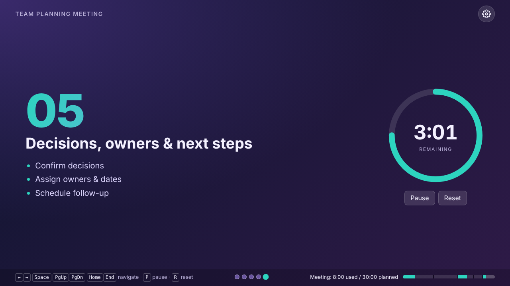

# meeting-agenda

Turns a meeting agenda into one self-contained HTML slide deck with a countdown timer for every item. The deck has no dependencies and makes no network calls; open it in any modern browser, including offline.



## Install

```bash
npx skills add sugatoray/aiskills --skill meeting-agenda
```

Or, in Claude Code, run `/plugin marketplace add sugatoray/aiskills`, then `/plugin install productivity-skills@sugatoray`.

## Ask for a deck

```text
/meeting-agenda --title "Team Planning Meeting" --total 30
10 min  Priorities for 2026 & 2027 (what are the priorities for 2026? for 2027?)
8 min   Identify trainings for 2027
5 min   Resourcing & budget
3 min   Risks & blockers
4 min   Decisions, owners & next steps
```

The agent turns this into agenda JSON, builds the deck with `scripts/build_deck.py`, and hands you `meeting-agenda.html`, along with a table of items and the planned total. Options: `--title`, `--total` (the target length, used to fill in missing item times), and `--output` (path).

To build a deck yourself without an agent:

```bash
python3 scripts/build_deck.py agenda.json -o meeting-agenda.html --title "Weekly sync"
```

## Present it

1. Open the HTML file in a browser (double-click it; no server needed).
2. Present with the keyboard. Each slide's timer starts when the slide is shown.
3. Click the gear in the top right to change the agenda.

### Keyboard

| Action | Keys |
|---|---|
| Next slide | `→`, `Space`, `Page Down` |
| Previous slide | `←`, `Shift+Space`, `Page Up` |
| First / last slide | `Home` / `End` |
| Pause / resume timer | `P` |
| Reset timer | `R` |
| Close editor without saving | `Esc` |

The Pause/Resume and Reset buttons under the ring, and the progress dots in the footer, do the same with the mouse.

### Timers

- The ring counts down from the item's minutes. It pauses when you leave the slide and continues from the same point when you come back.
- The ring turns **amber** in the last 20% of the item's time. Past zero it turns **red**, pulses, and counts up (`+1:05`).
- The footer shows `Meeting: M:SS used / M:SS planned` and a progress bar split into one section per item, sized by that item's planned minutes and separated by tick marks. Each section fills with the time spent on its own item, so moving between items (or skipping one) shows exactly where the time went. The current item's section is highlighted, and a section that runs over its item's time turns red without spilling into the next section. The whole bar turns amber at 80% of the planned total and red once past it. Hover over it to see the percentage used.

### Editing the agenda

The gear opens the editor, with one row per item: minutes (0.5 steps), title, and sub-points (one per line). Use ↑/↓ to reorder and ✕ to remove a row. The last row can't be removed.

| Button | What it does |
|---|---|
| **+ Add item** | Adds a blank row |
| **Reset to file defaults** | Asks first, then restores the agenda built into the file and forgets the browser copy |
| **Cancel** / `Esc` | Closes the editor and discards changes |
| **Save HTML** | Downloads a copy of `meeting-agenda.html` with this agenda built in. Share it, and it opens with your agenda. |
| **Apply** | Rebuilds the deck and remembers the agenda in this browser (`localStorage`) |

Every item needs a title and minutes greater than 0. Invalid rows are highlighted, and Apply/Save are blocked until they're fixed. While the editor is open the timer is paused and the keys don't change slides.

You can also edit the agenda directly in the file's `<script type="application/json" id="agenda-data">` block:

```json
{ "title": "Team Planning Meeting",
  "items": [ { "minutes": 10, "title": "Priorities", "points": ["2026", "2027"] } ] }
```

### Which agenda loads?

The agenda saved in this browser (from Apply) loads first. If there isn't one, the agenda built into the file loads.

## Run the tests

Requires Python 3.10+, `pytest` and `playwright`.

```bash
pip install pytest playwright
```

```bash
python -m playwright install chromium
```

```bash
python -m pytest
```

If you already have Chromium installed, point `CHROMIUM_PATH` at it and skip the `playwright install` step. The suite has 67 tests (55 for the deck, 12 for `build_deck.py`) and runs in about 25 seconds, because the timers use Playwright's fake clock. It also regenerates `meta/screenshots/`.

## Contents

| Path | What |
|---|---|
| `SKILL.md` | Instructions the agent follows |
| `assets/meeting-agenda.html` | The deck template (it's also a working deck: the 30-minute demo agenda) |
| `scripts/build_deck.py` | Validates agenda JSON and writes it into a copy of the template |
| `tests/` | pytest + Playwright suite |
| `meta/MAINTAINERS.md` | How the deck is built and how to change it |
| `meta/SECURITY.md` | Security model |
| `meta/screenshots/` | Normal slide, overtime, editor, progress by section |
