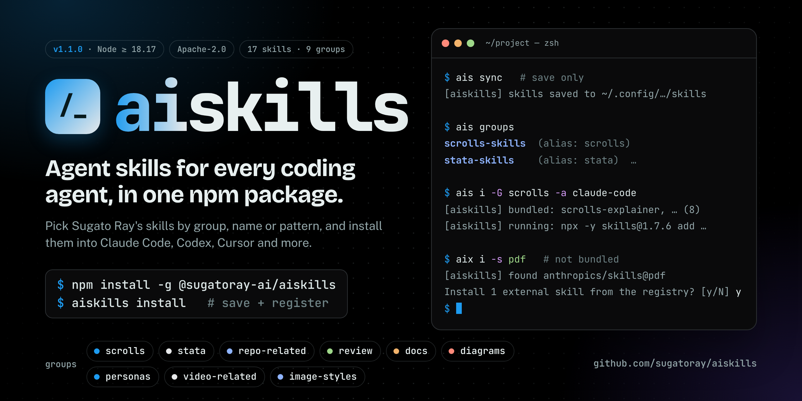

# @sugatoray-ai/aiskills

All of the agent skills from [sugatoray/aiskills](https://github.com/sugatoray/aiskills)
(scrolls, stata, personas, diagrams, docs, development, video, image styles), packaged
for npm. Every file under the repo's `skills/` folder ships, except what a
[`.skillsignore`](#leaving-files-out-skillsignore) leaves out. The skills are
flattened to one folder per skill (`skills/<skill-name>/`), and the repo's
nested layout can be rebuilt with `--nested` (see [Layouts](#layouts---flat-and---nested)).

**Full documentation:** [docs/docsite/](docs/docsite/README.md) (tutorial,
how-to guides, concepts, and a complete CLI, environment and error reference).
The same docs as one page with tabs and search: **<https://sugatoray.github.io/aiskills/>**
(or open [docs/docsite/index.html](docs/docsite/index.html) in a browser). AI agents can
load [docs/docsite/llms.txt](docs/docsite/llms.txt).

## Install

```sh
npm install -g @sugatoray-ai/aiskills
```

This adds three commands:

| Command | Same as |
| --- | --- |
| `aiskills` | |
| `ais` | `aiskills` (shorter to type) |
| `aix` | `aiskills --route`: also handles skills that aren't bundled (see [`--route`](#bundled-and-external-skills---route)) |

So `ais i -G scrolls` is `aiskills install -G scrolls`, and `aix i -s pdf` is
`aiskills --route install -s pdf`. The rest of this README uses `aiskills`.

`npm install` only adds these commands: the package has **no install step**,
so it makes no network calls, writes nothing to your home folder and changes
no agent. It works the same with npm, pnpm and bun. Then run:

```sh
aiskills install        # or, without a global install: npx @sugatoray-ai/aiskills install
```

which:

1. saves the skills to **`~/.config/sugatoray/aiskills/skills/`** and replaces any copy that's already there, and
2. runs `npx skills add ~/.config/sugatoray/aiskills --global --skill '*' --yes`,
   which registers every skill with the agents it detects (Claude Code, Codex, ...),
   and then
3. adds the install to the skills' install count on [skills.sh](https://skills.sh),
   in the background (see [The skills.sh install count](#the-skillssh-install-count);
   off with `--no-stats`).

### Upgrading

```sh
aiskills upgrade          # the latest aiskills, then your agents' skills, for the same agents
aiskills upgrade --check  # only say whether a newer version is out
```

From 1.0.0 the package follows [Semantic Versioning](https://semver.org/)
strictly: a change that can break existing use (a removed or renamed command,
option or variable, a changed default, or a different install folder or
layout) only comes in a new major version. New skills and groups are minor
releases. See [`CHANGELOG.md`](CHANGELOG.md).

Coming from 0.x: `aiskills upgrade` arrived in 0.9.0 (before that, run
`npm install -g @sugatoray-ai/aiskills@latest`, then `aiskills install`), and
1.0.0 no longer reads `AISKILLS_SKILLS_VERSION`: rename it to
`AISKILLS_SKILLS_LIB_VERSION`.

### As a project dependency, with `npx skills experimental_sync`

Because the package ships its skills flat (`skills/<skill-name>/SKILL.md`), it
also works with the `skills` CLI's own way of installing skills from a
project's `node_modules`:

```sh
npm install --save-dev @sugatoray-ai/aiskills
npx skills experimental_sync --agent claude-code --yes   # copies all of its skills into the project
```

This doesn't use `aiskills` or `~/.config/sugatoray/aiskills` at all, and the
skills are pinned to the version in your lockfile. `experimental_sync` is
marked experimental by the `skills` CLI.

## Layouts: `--flat` and `--nested`

`~/.config/sugatoray/aiskills/skills/` can be written in one of two layouts.
Either way, `npx skills add` installs exactly the same skills; only the folder
shape differs.

| Layout | `~/.config/sugatoray/aiskills/skills/` | Use it when |
| --- | --- | --- |
| **`--flat`** (default) | `skills/<skill-name>/...`, one folder per skill, as the npm package ships it | You just want the skills |
| **`--nested`** | `skills/<group>/<skill-name>/...` plus the group-level files (READMEs, `.claude-plugin/plugin.json`, `meta/`, …): the repo's `skills/` folder, byte for byte (minus anything a `.skillsignore` left out) | You browse or edit the skills, or a tool expects the repo's layout |

```sh
aiskills --nested                 # install, writing the nested layout
aiskills install --nested -G scrolls
aiskills sync --nested            # just rewrite the folder, no npx skills add
aiskills sync --flat              # back to flat
AISKILLS_LAYOUT=nested npm i -g @sugatoray-ai/aiskills
```

- **Placement:** `--nested` / `--flat` go before the command or after
  `install` / `sync`. `aiskills --nested` on its own means `install --nested`.
- **The choice is remembered** in `~/.config/sugatoray/aiskills/aiskills.json`
  and reused by later `install`, `sync`, `list` and `groups` runs until you
  pass the other flag.
- **Precedence:** a flag beats `AISKILLS_LAYOUT`, which beats the remembered
  choice. With none of them, the layout is flat.
- **How nesting is rebuilt:** the package carries
  `.aiskills/layout.json`, which records each skill's original folder (e.g.
  `scrolls-setup` → `scrolls/scrolls-setup`), and `.aiskills/nested/`, which
  holds the files that sit outside any skill folder. Both are copied next to
  `skills/`.
- **Groups work the same in both layouts.** A group's skills are the ones
  whose *original* folder is under the group's `source` in `marketplace.json`.

## CLI

```text
# -a/-s/-G accept comma-separated names and glob patterns ('scrolls-*', 'claude*')
aiskills install   [-g|-p] [-a agents] [-s skills] [-G groups] [-i] [-l] [--copy] [--route] [-y] [-n] [--nested|--flat] [--stats|--no-stats] [-- <extra npx skills args>]   # alias: i
aiskills uninstall [-g|-p] [-a agents] [-s skills] [-G groups] [--route] [--purge] [-f] [-n] [-- <extra args>]   # aliases: r, rm, remove
aiskills installed [-g|-p]   # skills currently installed from ~/.config/sugatoray/aiskills   (alias: ls)
aiskills groups [--json]     # skill groups (from marketplace.json) and their skills   (alias: g)
aiskills find <query>        # search the skills registry (= npx skills find)   (alias: f)
# --route (before or after the command) hands non-bundled skills to npx skills;
# a skill it finds by lookup is shown and confirmed ([y/N]) unless -y; -n previews an install
aiskills --route install|uninstall|installed ...
aiskills skills <args...>    # passthrough to `npx skills`; `:root` = ~/.config/sugatoray/aiskills
aiskills sync [--nested|--flat] [--stats|--no-stats]   # only refresh ~/.config/sugatoray/aiskills/skills
aiskills list                # list the skills available in the saved folder
aiskills path                # print ~/.config/sugatoray/aiskills   (alias: p)
aiskills info [--full] [--json]   # this setup: versions, folders, settings and their sources (offline)
aiskills upgrade [<version>|<tag>] [--check [--json]] [--no-refresh] [-n] [-y]   # install the latest aiskills, then update your agents' skills
aiskills releases [<n>|all] [-L|--last <n|all>] [--downloads [period]] [--chart|--table] [--by day|week|month] [--ascii] [--json]   # latest releases on npm (alias: rel)
```

Short aliases, mostly following `npm`'s own:

| Alias | Command | Like |
| --- | --- | --- |
| `i` | `install` | `npm i` |
| `r` (also `rm`, `remove`) | `uninstall` | `npm r` |
| `ls` | `installed` | `npm ls` |
| `g` | `groups` | |
| `f` | `find` | |
| `rel` | `releases` | |
| `p` | `path` | |
| `h` (also `-h`, `--help`) | `help` | |

Options work the same with an alias: `aiskills i -G scrolls -a claude-code`.
`sync`, `skills` and `list` have no single-letter alias on purpose: `s` would
be ambiguous between `sync` and `skills`, and `l` too easily confused with
`ls` (= `installed`).

Install examples:

```sh
aiskills install -a claude-code,codex          # only these agents
aiskills install -s scrolls-setup,scrolls-help # only these skills
aiskills install --project                     # into the current project
aiskills install --group scrolls --global --agent claude-code
aiskills install -n -G stata                   # preview: what would be installed, and the commands
aiskills install -i                            # pick skills and agents from a list (npx skills' own pickers)
aiskills install -l                            # only the agents you picked last time (--last-agents)
aiskills sync                                  # only save the skills; don't register them
```

## Skill groups

### Where the groups come from

The package bundles the repo's `.claude-plugin/marketplace.json` (the Claude
Code plugin marketplace file) and saves it next to the skills:

```text
~/.config/sugatoray/aiskills/
├── .claude-plugin/marketplace.json   <- read only to define groups
├── .aiskills/layout.json             <- each skill's original nested folder
└── skills/                           <- what `npx skills add` installs from
```

The file is only used to group the skills. Nothing is installed as a Claude
Code plugin, and installs still go through `npx skills add ... --skill <name>`.

### How a group is built

Each entry under `plugins` is one group. Its `source` points into the repo's
nested layout; `.aiskills/layout.json` maps that to the skills, so groups work
whether `skills/` is [flat or nested](#layouts---flat-and---nested):

```jsonc
{
  "metadata": { "pluginRoot": "./skills" },
  "plugins": [
    {
      "name": "scrolls-skills",   // -> group name: scrolls-skills (alias: scrolls)
      "source": "./scrolls",      // -> group skills: every SKILL.md under skills/scrolls/
      ...
    }
  ]
}
```

| Part | Where it comes from |
| --- | --- |
| **Group name** | The entry's `name` field, used exactly as written in `marketplace.json`, e.g. `scrolls-skills`. |
| **Skills in the group** | Every `SKILL.md` under the entry's `source` folder (relative to `metadata.pluginRoot`). A skill's name is the `name:` in its `SKILL.md` frontmatter. |
| **Alias** | **Not in the file.** The CLI makes it by removing a trailing `-skills` from the group name, so `scrolls-skills` can also be written `scrolls`. A name that doesn't end in `-skills` has an alias equal to the name itself. |
| **`all`** | **Not in the file.** A built-in group that means every skill in the package, including skills that belong to no group. |

Entries whose `source` isn't a local folder (for example a git URL) are
skipped, because those skills aren't in the package.

### Current groups

Run `aiskills groups` (or `aiskills groups --json`) to see the list for your
installed version. At the time of writing:

| Group name (from `marketplace.json`) | Alias (made by the CLI) | Skills |
| --- | --- | --- |
| `scrolls-skills` | `scrolls` | scrolls-setup, scrolls-update, scrolls-hide, scrolls-unhide, scrolls-remove, scrolls-restore, scrolls-help, scrolls-explainer |
| `stata-skills` | `stata` | stata-recipes |
| `repo-related-skills` | `repo-related` | create-issues-update-pr |
| `review-skills` | `review` | code-review |
| `docs-skills` | `docs` | create-lib-docs |
| `diagrams-skills` | `diagrams` | network-flow |
| `personas-skills` | `personas` | prodigy |
| `video-related-skills` | `video-related` | dynamic-promo-video |
| `image-styles-skills` | `image-styles` | artwallbg, commentdrop |
| `all` (built in) | | every skill |

`newsletter-ai` isn't in the package: `skills/newsletters/.skillsignore`
leaves it out (see [`.skillsignore`](#leaving-files-out-skillsignore)). It is
still in the repo, so `npx skills add sugatoray/aiskills --skill newsletter-ai`
installs it, and so does `aix install -s sugatoray/aiskills@newsletter-ai`.

### Choosing groups on the command line

- `-G` / `--group` accepts the group name **or** its alias, in any letter case:
  `scrolls-skills`, `scrolls`, and `Scrolls` all select the same group.
- Give several groups as a comma-separated list (`-G scrolls,personas`) or
  repeat the option (`-G scrolls -G personas`).
- `-G` combines with `-s`. You get the union of the named skills and every
  skill in the named groups.
- Glob patterns work too, matched against both the group name and the alias:
  `-G 'scroll*'`, `-G '*-skills'`, `-G 'd*'` (docs and diagrams). See
  [Patterns](#patterns-for--s--g-and--a).
- An unknown group name, or a pattern that matches no group, fails before
  anything is installed and lists the valid names.

```sh
aiskills install --group scrolls-skills --global --agent claude-code   # full group name
aiskills install --group scrolls --global --agent claude-code          # same, via alias
aiskills install -G scrolls,personas -s create-lib-docs -a claude-code,codex
aiskills install -G stata --project
aiskills uninstall -G scrolls          # remove every installed skill in the group
```

At npm install time, `AISKILLS_GROUPS` does the same thing:
`AISKILLS_GROUPS=scrolls,personas npm i -g @sugatoray-ai/aiskills`.

### Adding a group

Add a plugin entry to the repo's `.claude-plugin/marketplace.json` that points
at a folder under `skills/`, then publish a new version of this package. The
new group appears automatically; no CLI code needs to change.

## Patterns for `-s`, `-G` and `-a`

`-s/--skill`, `-G/--group` and `-a/--agent` all accept
[glob](https://en.wikipedia.org/wiki/Glob_(programming)) patterns, on both
`install` and `uninstall`. The same applies to the `AISKILLS_SKILLS`,
`AISKILLS_GROUPS` and `AISKILLS_AGENTS` defaults.

| Pattern | Matches | Example |
| --- | --- | --- |
| `*` | any text, including none | `scrolls-*` |
| `?` | exactly one character | `?????-recipes` |
| `[abc]` | one of the listed characters | `scrolls-[hu]*` → scrolls-help, -hide, -unhide, -update |
| `[a-z]` | one character in the range | `scrolls-[r-u]*` |
| `[!abc]` or `[^abc]` | one character **not** listed | `scrolls-[!hu]*` → scrolls-remove, -restore, -setup |

Rules:

- **Ignores case.** This applies to patterns and plain names alike.
- **Whole-name match.** `scroll*` matches `scrolls-skills`; `croll` alone
  matches nothing.
- **Mix freely.** Patterns and plain names can share one comma-separated list
  (`-s 'scrolls-*,prodigy'`), and `-s/-G/-a` can each be repeated.
- **No match is an error.** A pattern that matches nothing stops the command
  before anything changes, and lists the valid values.
- **Quote patterns** (`'scrolls-*'`). Otherwise your shell may expand them
  into file names first.

What each option matches against:

| Option | Matched against |
| --- | --- |
| `-s/--skill` | **install:** every skill in the package. **uninstall:** every skill in the package plus every skill installed from `~/.config/sugatoray/aiskills`. |
| `-G/--group` | Group names **and** aliases from [Skill groups](#skill-groups). `all` is a built-in group; `-G '*'` means the same. |
| `-a/--agent` | The agent ids `npx skills` accepts (`claude-code`, `codex`, `cursor`, `qoder`, `qoder-cn`, …). The CLI reads this list from `npx skills` itself, so it always matches your installed version. |

Special cases:

- **`-s '*'`** means every skill, just as if you gave no `-s`.
- **`-a '*'`** is passed straight to `npx skills`, which reads it as "all
  agents". It isn't expanded.
- **Plain agent names** aren't checked by `aiskills`. They go to
  `npx skills`, which reports invalid ones.
- **Uninstall with patterns or groups** only removes skills that are actually
  installed from `~/.config/sugatoray/aiskills`. Names typed out in full are
  always passed to `npx skills remove`, so `-f` can still remove a skill that
  came from somewhere else.
- **Check first.** `-n` on uninstall shows what a pattern expands to, and
  install prints `selected: ...` and `agents: ...` before running.

```sh
aiskills install -G 'scroll*,d*' -a 'claude*,codex'      # scrolls + docs + diagrams -> claude-code, codex
aiskills install -s 'stata-*' -a 'cursor,qoder*'         # -> cursor, qoder, qoder-cn
aiskills install -s 'scrolls-*,prodigy' --project
aiskills uninstall -s 'scrolls-[hu]*' -n                 # preview: help, hide, unhide, update
aiskills uninstall -s 'scrolls-[hu]*' -a 'claude*'
aiskills uninstall -G 'd*'                               # docs-skills + diagrams-skills
AISKILLS_GROUPS='pers*' AISKILLS_AGENTS='claude-c*' npm i -g @sugatoray-ai/aiskills
```

## Bundled and external skills (`--route`)

Without `--route`, `aiskills` only manages the **bundled** skills, the ones in
`~/.config/sugatoray/aiskills/skills/`. It rejects any other skill name and
suggests adding `--route`.

With `--route`, every `-s` entry that isn't bundled is handed to `npx skills`. The `aix` command
always works this way: `aix ...` is `aiskills --route ...`.
That lets you manage bundled and external (registry / GitHub) skills from one
CLI. `--route` can go before or after the command, or you can set
`AISKILLS_ROUTE=1`.

```sh
aiskills --route install -s scrolls-setup,pdf -a claude-code
aiskills install --route -s scrolls-setup,pdf -a claude-code   # same
```

### `install --route`

Each `-s` entry is handled as follows:

| `-s` entry | What happens |
| --- | --- |
| A bundled skill name, or a pattern | Installed from `~/.config/sugatoray/aiskills`, the same as without `--route`. |
| A bare name that isn't bundled, e.g. `pdf` | Looked up with `npx skills find pdf`. If **exactly one** result has that exact name, it is shown and, once you **confirm**, `npx skills add <owner/repo>@pdf` installs it. |
| `owner/repo@skill` | Passed straight to `npx skills add owner/repo@skill`, with no lookup. |
| `owner/repo`, a git URL, or a local path | Passed straight to `npx skills add <spec>`, which installs the skills found there. |

- **Same flags.** External installs get the same `-g/-p`, `-a` (patterns
  included) and `--copy` as the bundled ones.
- **Lookups first.** Every external lookup runs before anything is installed.
  If one fails, nothing is installed.
- **Confirmation.** Each skill a lookup found is listed (`owner/repo@skill`,
  install count, the name you typed), then `aiskills` asks
  `Install <n> external skill(s) from the registry? [y/N]`. Only `y`/`yes`
  installs anything, bundled skills included. Without a terminal it stops
  unless you pass `-y`/`--yes`; `-n`/`--dry-run` shows the matches and the
  exact commands without installing. A pinned `owner/repo@skill` isn't asked
  about.
- **Several matches.** If more than one skill has the exact name, the command
  stops and lists them, e.g. `a/one@dupe` and `b/two@dupe`. Pick one with
  `-s owner/repo@skill`. `aiskills` never chooses for you.
- **No exact match.** The command stops and shows the closest results from
  `npx skills find`.
- **Patterns and groups** (`-s 'x*'`, `-G`) only match bundled skills. The
  registry can't be searched with a pattern, so use `aiskills find <query>` to
  browse it.

```sh
aiskills find pdf                                    # browse the registry
aiskills --route install -s pdf -a claude-code       # look up, confirm, install
aiskills --route install -n -s pdf                   # look up only: show what would be installed
aiskills --route install -s anthropics/skills@docx   # pinned, no lookup
aiskills --route install -G scrolls -s pdf -p        # bundled group + external skill, project scope
```

External skills are installed straight from their source, the same way
`npx skills add` would install them. They aren't copied into
`~/.config/sugatoray/aiskills`.

### `uninstall --route`

- **Any source.** `-s` names and patterns also match skills installed from
  other sources, not only bundled ones. For example,
  `aiskills --route uninstall -s 'pdf,do*'` removes the external `pdf` and
  `docx`.
- **`owner/repo@skill`** is reduced to `skill`. A bare `owner/repo` is
  rejected, because it doesn't name a skill.
- **Not installed.** Names that aren't installed in that scope are skipped
  with a warning.
- **Full uninstall** (no `-s`/`-G`) still removes **only bundled** skills,
  even with `--route`. External skills are removed only when you name them.
- **Same name from two sources.** `npx skills remove` removes by name, so
  `--route uninstall -s <name>` removes the skill whichever source it came
  from.

```sh
aiskills --route uninstall -s pdf -n           # preview
aiskills --route uninstall -s pdf,docx
aiskills --route uninstall -s anthropics/skills@pdf
```

### `installed --route`

Lists **every** installed skill in that scope, with a source column:
`bundled` for skills from `~/.config/sugatoray/aiskills`, otherwise the
source `npx skills` recorded (e.g. `anthropics/skills`).

```text
$ aiskills --route installed
docx                       anthropics/skills              -                      Claude Code
scrolls-setup              bundled                        scrolls-skills         Claude Code
```

## Uninstall

`aiskills uninstall` calls `npx skills remove ... --yes`.

- **Full uninstall** (no `-s`): removes every skill that `npx skills list`
  says was installed from `~/.config/sugatoray/aiskills`. Skills with the same
  name from other sources aren't touched.
- **Partial uninstall** (`-s a,b` and/or `-G group`, either may use
  [patterns](#patterns-for--s--g-and--a)): removes only the named skills, or
  every installed skill that matches or belongs to the named groups. Names this
  package doesn't provide are rejected unless you pass `-f/--force`.
- **Per agent** (`-a codex`, or a pattern like `-a 'qoder*'`): unlinks the
  skills from those agents only.
- **`--purge`**: after a full uninstall, also deletes
  `~/.config/sugatoray/aiskills`. Without it, the files are kept so that
  `aiskills install` can re-add them offline.
- **`-n/--dry-run`**: prints the exact `npx skills` command without running it.

```sh
aiskills uninstall -n                          # preview
aiskills uninstall -s scrolls-hide,prodigy     # partial
aiskills uninstall -a codex                    # unlink from Codex only
aiskills uninstall -p                          # project-level installs in $PWD
aiskills uninstall --purge                     # everything, plus the local folder
npm uninstall -g @sugatoray-ai/aiskills        # then remove the npm package
```

npm does not run uninstall hooks, so run `aiskills uninstall` **before**
`npm uninstall -g`. If the CLI is already gone, either of these does the same
job:

```sh
npx @sugatoray-ai/aiskills uninstall --purge
npx skills remove <skill...> --global --yes && rm -rf ~/.config/sugatoray/aiskills
```

### Using `npx skills` directly

`aiskills skills ...` forwards every argument to `npx skills` and replaces
`:root` with the install folder, so you can use any `skills` command or flag:

```sh
aiskills skills list -g                         # npx skills list -g
aiskills skills add :root -s prodigy -g -y      # npx skills add ~/.config/sugatoray/aiskills -s prodigy -g -y
aiskills skills remove prodigy -a codex -g -y   # npx skills remove prodigy -a codex -g -y
aiskills skills update -g                       # npx skills update -g
```

`install` and `uninstall` also pass anything after `--` through to
`npx skills`.

## The skills.sh install count

[skills.sh](https://skills.sh) shows how often each skill is installed, counted
by `npx skills add` when it installs from GitHub. `aiskills install` installs
from a local folder (`~/.config/sugatoray/aiskills`), which `npx skills` doesn't
count. So after a successful install of bundled skills, `aiskills` also runs

```sh
npx -y skills@1.7.6 add sugatoray/aiskills --skill <each installed skill> --agent <your -a, or universal> --copy --yes
```

in a new temp folder, in the background, and deletes the folder when it's done.
That run makes a shallow clone of the repo from github.com and sends skills.sh
the same install event any `npx skills add sugatoray/aiskills` sends (after
asking api.github.com whether the repo is public). Nothing it installs is kept,
and your agents use the copy in `~/.config/sugatoray/aiskills` as before.

- **No github.com, no count:** behind a firewall, the clone or the check fails,
  nothing is counted, and nothing is shown. The install itself has already
  succeeded either way.
- **Not counted:** failed installs, `-n/--dry-run`, external skills from
  `--route` (`npx skills add owner/repo@skill` counts those itself), `sync`.
- **Turn it off:** `--no-stats` (remembered in `aiskills.json` until `--stats`;
  `aiskills sync --no-stats` sets it without installing), or
  `AISKILLS_STATS=0`. It's always off when `DO_NOT_TRACK`, `DISABLE_TELEMETRY`
  or `CI` is set.

`aiskills install` prints one line when it starts the count:
`[aiskills] adding this install to the skills.sh count in the background (turn off: --no-stats)`.
`AISKILLS_STATS_FOREGROUND=1` waits for it and shows its output, to see why
a count fails.

## Environment variables

| Variable | Effect |
| --- | --- |
| `AISKILLS_HOME` | Override the install root (default `~/.config/sugatoray/aiskills`) |
| `AISKILLS_SCOPE=project` | Same as `-p`: work on the current project instead of globally |
| `AISKILLS_AGENTS` | Comma-separated agents or [patterns](#patterns-for--s--g-and--a), passed as `--agent` |
| `AISKILLS_SKILLS` | Comma-separated skills or [patterns](#patterns-for--s--g-and--a), passed as `--skill` (default: all) |
| `AISKILLS_GROUPS` | Comma-separated group names, aliases or [patterns](#patterns-for--s--g-and--a) (see [Skill groups](#skill-groups)); combined with `AISKILLS_SKILLS` |
| `AISKILLS_COPY=1` | Pass `--copy` to `npx skills add` |
| `AISKILLS_LAYOUT=flat\|nested` | Same as `--flat` / `--nested` (see [Layouts](#layouts---flat-and---nested)) |
| `AISKILLS_ROUTE=1` | Same as `--route` |
| `AISKILLS_SKILLS_LIB_VERSION` | Version of the `skills` CLI that `npx` runs (default: the tested, pinned version). Also `latest`, `next`, an npm range (`~1.7.4`) or an interval (one of `...`, `?` or `*` is an open end): `[x, ...)` is `>=x`, `(x, ...)` is `>x`, `[x, y)` is `>=x <y`, `(..., x]` is `<=x`. With a range, npm picks the newest version its rules (e.g. `min-release-age`) allow |
| `AISKILLS_SKILLS_VERSION` | Removed in 1.0.0 (the old name of `AISKILLS_SKILLS_LIB_VERSION`): no longer read, so the pinned version runs; rename it |
| `npm_config_min_release_age`, `npm_config_before` | npm's release-age rule, passed on to `npx`: `npm_config_min_release_age=0 aiskills installed` relaxes it for one run |
| `AISKILLS_STATS=0\|1` | Same as `--no-stats` / `--stats` for one command, not remembered (see [The skills.sh install count](#the-skillssh-install-count)) |
| `AISKILLS_STATS_FOREGROUND=1` | Wait for the skills.sh count and show its output |
| `DO_NOT_TRACK`, `DISABLE_TELEMETRY` | Turn off the skills.sh count, and the `skills` CLI's own telemetry |

### npm's release-age rule (`min-release-age`, `before`)

If your `.npmrc` says `min-release-age=7` (or `before=<date>`), npm refuses
versions newer than that, including the `skills` CLI version `aiskills` runs
while it's that new. `aiskills` then explains it after npm's error, and you can:

```sh
npm_config_min_release_age=0 aiskills installed          # relax the rule for one run
AISKILLS_SKILLS_LIB_VERSION='(..., 1.7.6]' aiskills installed  # let npm fall back to an older, untested version
```

or wait until the version is old enough. `min-release-age-exclude[]=skills`
doesn't help: `npx` ignores it.

## Security

Skills are code that your agent may run with your permissions. See
[SECURITY.md](SECURITY.md) for what this package writes, which network calls
happen (including the skills.sh install count, and how to turn it and the
`skills` CLI's telemetry off), known limitations,
and how to report a vulnerability.

## Maintainers: building & publishing

Maintainer docs: [docs/meta/MAINTAINERS.md](docs/meta/MAINTAINERS.md) (workflow
and releases), [docs/meta/ARCHITECTURE.md](docs/meta/ARCHITECTURE.md) (how it's
built), [docs/meta/FEATURES.md](docs/meta/FEATURES.md) (every feature, with
where it's documented and tested) and [src/scripts/README.md](src/scripts/README.md)
(what each code folder is for: `core/` ships, `pack/` runs at `npm pack`,
`docs/` builds the docs and banner).

The package source lives in `src/packages/aiskills/` of the repo. The skills are **not**
committed here. `prepack` (`src/scripts/pack/vendor-skills.mjs`) runs right before
`npm pack` / `npm publish` and:

- flattens `<repo>/skills/<group>/<skill>/` into `skills/<skill>/` (the folder
  is named after the skill's `name:`);
- writes `.aiskills/layout.json` (each skill's original folder, plus the list
  of files outside any skill folder) and copies those files to
  `.aiskills/nested/` at their original paths;
- leaves out whatever a `.skillsignore` excludes (see below);
- copies `<repo>/.claude-plugin/marketplace.json`.

It stops with an error if two skills share a name, a skill sits inside
another skill, or a name can't be used as a folder name.

```sh
cd src/packages/aiskills
npm test              # run the test suite first
npm run vendor        # optional: vendor locally to inspect
npm run pack:dry      # list what will ship
# move the CHANGELOG.md "Unreleased" entries under the new version, with today's date
npm version patch     # bump the version (patch/minor/major, see CHANGELOG.md)
npm publish           # prepack re-vendors the skills automatically
# if npm stages it: npm stage list, then npm stage approve <stage-id> (2FA)
npm run clean         # remove the vendored copy
```

### Leaving files out: `.skillsignore`

Put a `.skillsignore` in the repo's `skills/` folder, or in any folder below
it, to keep files out of the npm package (and so out of every install). It
uses `.gitignore` syntax, and its rules apply to its own folder and below:

```gitignore
# skills/.skillsignore  (comments go on their own line, as in .gitignore)

# every tests/ folder, at any depth
**/tests/
# a "/" in the middle anchors to this folder, so use **/ for any depth
**/meta/MAINTAINERS.md
# all .log files except keep.log
*.log
!keep.log
# ignoring a skill's folder drops the whole skill
scrolls/wip-skill/
```

| Syntax | Meaning |
| --- | --- |
| `# …` at the start of a line, blank line | Ignored; `\#` / `\!` for a literal leading `#` / `!`. A `#` later in a line is part of the pattern. |
| `name` | A file or folder with that name, at any depth |
| `/name`, `a/name` | A leading or middle `/` anchors to the `.skillsignore`'s folder |
| `name/` | Folders only |
| `*`, `?`, `[abc]`, `[!abc]` | Within one folder name |
| `**` | Across folders: `**/x`, `x/**`, `a/**/b` |
| `!pattern` | Re-include something an earlier rule excluded |

- The last matching rule wins; rules in a deeper `.skillsignore` come after
  the outer ones.
- As in git, a file inside an ignored folder can't be re-included.
- `.skillsignore` files themselves never ship.
- Ignoring only a `SKILL.md` is refused (the skill would have no definition):
  ignore the skill's folder instead.
- What was left out is listed under `ignored` in the package's
  `.aiskills/layout.json`, and `--nested` rebuilds the repo's `skills/` folder
  without it.

Check the result with `npm run vendor` (or `npm run pack:dry`), then
`npm run clean`.

### Layout

```text
src/packages/aiskills/
├── package.json              # "bin": { aiskills, ais -> bin/aiskills.mjs; aix -> bin/aix.mjs }
├── README.md
├── CHANGELOG.md              # Keep a Changelog + SemVer
├── SECURITY.md               # reporting + what the package touches
├── bin/
│   ├── aiskills.mjs          # thin entry point: imports src/scripts/core/cli.mjs
│   └── aix.mjs               # the same, in --route mode
├── src/
│   ├── scripts/              # see src/scripts/README.md
│   │   ├── core/             # what ships: the runtime code
│   │   │   ├── cli.mjs           # the `aiskills` command
│   │   │   └── installer.mjs     # shared logic (sync, npx skills calls, groups, patterns, --route)
│   │   ├── pack/             # packaging, run at npm pack (not published)
│   │   │   ├── vendor-skills.mjs # prepack: copies <repo>/skills in
│   │   │   └── skillsignore.mjs  # .skillsignore rules
│   │   └── docs/             # docs and banner (not published)
│   │       ├── build-skills-docs.mjs  # docs/docsite/skills/ from the bundled skills
│   │       ├── build-docs-html.mjs    # docs/docsite -> index.html
│   │       ├── create-banner.mjs      # docs/banner/ page and PNG
│   │       ├── themes.mjs             # the 11 docs/banner themes; default Lights Out
│   │       └── templates/             # docs-template.html, banner-template.html
│   └── test/                 # node:test suite (not published)
├── docs/docsite/             # user documentation, llms.txt, index.html (not published)
├── docs/banner/              # banner: config.yaml, editor page, banner_2x.png (not published)
├── docs/meta/                # ARCHITECTURE, FEATURES, MAINTAINERS (not published)
├── docs/.scrolls/, SCROLLS.md, CLAUDE.md, AGENTS.md   # project memory (not published)
├── LICENSE                   # Apache-2.0, for the package (committed; never vendored)
└── skills/, .aiskills/, .claude-plugin/               # vendored at pack time (git-ignored)
```

### Tests

The suite uses the built-in `node:test` runner and has no dependencies.

```sh
npm test            # unit, CLI, packaging, docs and banner tests: offline, about a minute
npm run test:e2e    # also a real install with the real `npx skills` (needs network)
```

| File | What it covers |
| --- | --- |
| `src/test/unit.test.mjs` | The pure helpers: glob matching, pattern expansion, reading skill names, groups and aliases, skill selection, `--route` spec parsing, `AISKILLS_*` env parsing. |
| `src/test/cli.test.mjs` | `bin/aiskills.mjs` → `src/scripts/core/cli.mjs` (the `aiskills` command), run as real processes against a small fixture package. A stand-in `npx` placed first on `PATH` records every call and returns canned `list`, `find` and agent-list output, so the tests check the exact `npx skills` commands issued. The `aix` confirmation is tested without a terminal and, through util-linux `script`, in a real pseudo-terminal answering the `[y/N]` prompt. |
| `src/test/skills-version.test.mjs` | `AISKILLS_SKILLS_LIB_VERSION`: exact versions, tags, npm ranges and interval notation (`[x, ...)`, `(x, y]`, `(..., x]`, …) turned into npm ranges, and everything else refused; the `skills@<range>` argument quoted for `cmd.exe`; npm's release-age variables passed to `npx`; the explanation when npm's age rule blocks the `skills` CLI; and `npm run audit:skills` (resolution, age and advisory checks, with a stand-in `npm`). |
| `src/test/stats.test.mjs` | The skills.sh install count: `resolveStats` (flag, `AISKILLS_STATS`, remembered choice, default on; `DO_NOT_TRACK`, `DISABLE_TELEMETRY` and CI always off), the exact `npx skills add sugatoray/aiskills` command, that it runs after a successful bundled install in a temp folder that is then removed (in the foreground and in the background), only for the installed skills and chosen agents, never for failed installs, `-n`, `--route` externals or `sync`, and that a failing count (github.com unreachable) is silent and leaves the exit status alone. |
| `src/test/skillsignore.test.mjs` | The `.skillsignore` parser and matcher, and how the vendor step applies it (nested files, `!`, dropped skills, refused `SKILL.md`, `--nested`). |
| `src/test/packaging.test.mjs` | `npm run vendor` / `clean` and `npm pack --dry-run`: `skills/` is flat with a `SKILL.md` in every folder; mapped back through `layout.json`, the shipped files equal every git-tracked file under the repo's `skills/` that no `.skillsignore` excludes, byte for byte (with `.gitignore` files renamed); only `bin/` and the two runtime files in `src/scripts/core/` ship as code, and `package.json` has no install-time script: `src/scripts/pack/`, `src/scripts/docs/`, `src/scripts/README.md`, `src/test/`, `docs/` and the scrolls files don't. It also pins the `src/scripts/` layout (`core/`, `pack/`, `docs/`), the rule that imports only point down, and that `src/scripts/README.md` describes every file. |
| `src/test/docs.test.mjs` | The user docs in `docs/docsite/`: the create-lib-docs checker (links, anchors, fences, reachability) passes and `llms.txt` is current; every command, alias, option, environment variable and error message in `src/scripts/` is in the reference; every example marked `<!-- verify -->` is run against the repo's real skills and must print exactly what the page shows. |
| `src/test/docs-skills.test.mjs` | The Skills section of the docs (`docs/docsite/skills/`): one page per skill the package really ships, up to date with each `SKILL.md` (description, version, group, how it starts, requirements, source link, shipped files), and a Skills list on the landing page right after Getting started. |
| `src/test/themes.test.mjs` | The shared themes (`src/scripts/docs/themes.mjs`): 11 themes, Lights Out the default, every token for light and dark, text/link/button contrast of at least 4.5:1 in every theme and mode, Google Fonts links, and generated CSS (banner rules never reach outside the banner). |
| `src/test/banner.test.mjs` | The banner (`docs/banner/`): `config.yaml` parsing, "auto" values from `package.json` and the bundled skills, the generated page is up to date (`npm run banner:check`), the README opens with `banner_2x.png` (2560 × 1280), and, with Playwright, the editor: saved edits, Reset, unreadable ink disabled, text contrast ≥ 4.5:1 on every allowed background, and PNG export sizes. |
| `src/test/docs-html.test.mjs` | The single-page HTML docs (`docs/docsite/index.html`): it is up to date, holds every page and diagram in tabs that follow the landing page, and, when Playwright and cdnjs are available, every page renders in Chromium with every link going to a page and heading that exist. |
| `src/test/docs-workflow.test.mjs` | The GitHub Pages workflow (`.github/workflows/aiskills-docs.yml` at the repo root): it runs on `master` and by hand, watches paths that exist, builds with `npm run docs:site` on the branch being built, uploads `site/` and deploys it with `actions/deploy-pages`; `site/` is git-ignored and not published. |
| `src/test/e2e.test.mjs` | Skipped unless `AISKILLS_E2E=1`. Packs the package, installs it with `npm install -g` into a throwaway prefix and `HOME`, and drives the real `npx skills`: the npm install changes nothing, `aiskills install` with a group, group and pattern installs, partial uninstall, `--nested` rebuilding the repo's folder exactly, `npx skills experimental_sync` from a project's `node_modules`, `--purge`. |

Every test works in a temporary folder with its own `HOME` and `AISKILLS_HOME`. The packaging and e2e tests use a temporary copy of the repo, so nothing is written into this folder or your real home folder. The CLI tests are skipped on Windows because the stand-in `npx` is a POSIX script, and `npm run test:e2e` uses POSIX syntax to set the variable.

npm never ships files named `.gitignore`/`.npmignore`. To get around this, the
vendor step renames them to `_gitignore`/`_npmignore` (in `skills/` and
`.aiskills/nested/`), and the installer renames them back when it writes to
`~/.config/sugatoray/aiskills/skills`.

## License

The `@sugatoray-ai/aiskills` package (the `aiskills`, `ais` and `aix`
commands and everything else this package adds) is licensed under the
[Apache License 2.0](LICENSE). Copyright 2026 Sugato Ray.

Each bundled skill keeps the license in its `SKILL.md` (`license:`); today
every bundled skill is MIT, as in the
[sugatoray/aiskills](https://github.com/sugatoray/aiskills) repo.
