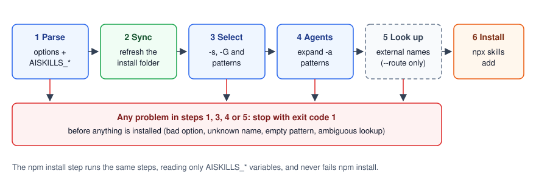

# How aiskills works

`aiskills` saves the bundled skills to one folder on your machine and asks `npx skills` to install them from there; it never writes into agent folders itself. Installing the npm package does neither: both happen only when you run `aiskills install`.

The same, as steps:

1. **Sync.** The npm package carries the skills (one folder per skill), a map of their original folders (`.aiskills/layout.json`) and the repo's `marketplace.json`. `aiskills` copies them to the **install folder**, `~/.config/sugatoray/aiskills` (or `AISKILLS_HOME`), replacing `skills/` each time.
2. **Add.** It runs `npx -y skills@1.7.6 add <install folder>` with your skills, agents and scope.
3. **Install.** `npx skills` installs the skills into each agent's folder (`~/.claude/skills/`, `~/.agents/skills/`, or the project's folders with `-p`) and records where each one came from.

With `--route`, step 2 also runs `npx skills find` and `npx skills add <owner/repo@skill>` for skills that aren't bundled.

## Who owns what

| Thing | Owner | `aiskills` |
| --- | --- | --- |
| The skills in the package | The package version you installed | Reads |
| `~/.config/sugatoray/aiskills/` | `aiskills` | Writes; `skills/` is replaced on every sync |
| Agents' skill folders | `npx skills` | Never touches |
| The record of installed skills | `npx skills` (`npx skills list --json`) | Reads, to know what it installed |

A skill counts as installed **by `aiskills`** when `npx skills list --json` reports it with `sourceType` `local` and `source` equal to the install folder. That is how a full `aiskills uninstall` removes exactly its own skills and leaves same-named skills from other sources alone.

## What a command does

`aiskills install`, step by step:

1. Parse the options. `AISKILLS_*` variables give the defaults; options replace them.
2. Sync the install folder.
3. Turn `-s` and `-G` (names, aliases, patterns) into exact skill names.
4. Expand `-a` patterns against the agent list `npx skills` reports.
5. With `--route`, look up every external name.
6. Run `npx skills add` for the bundled skills, then once per external skill.

Every check and lookup in steps 1, 3, 4 and 5 runs before step 6. A problem stops the command with exit code 1 and installs nothing.

`uninstall` reads `npx skills list --json`, keeps the rows from the install folder (or any source with `--route`), matches `-s`/`-G` against them, and runs `npx skills remove`.

## Why it works this way

- **One tool owns the agent folders.** `npx skills` already knows every agent's folder layout and keeps a record. Delegating to it keeps `aiskills` small and gives it new agents for free.
- **A local folder works offline.** After the npm install, `aiskills install` needs no network except to fetch the `skills` CLI the first time.
- **No runtime dependencies.** The package is plain Node.js.

## Trade-offs and limits

- **`npx skills` output is mixed in.** `aiskills` lets `npx skills` print to your terminal. Use exit codes and `aiskills installed` to check results.
- **Two pieces of `npx skills` text are parsed**: the "Valid agents:" list (for `-a` patterns) and `find` results (for `--route`). A new `skills` release could change them, which is one reason the version is pinned.
- **Updates come with the package, and you apply them.** Skills change when you install a newer `@sugatoray-ai/aiskills` and run `aiskills install` again; installing the package by itself never changes your agents.

See also: [Layouts](layouts.md) · [Security model](security.md) · [Files and schemas](../reference/files.md)
