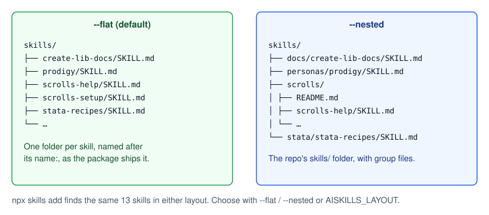

# Layouts: flat and nested

The install folder's `skills/` can be written flat (one folder per skill, the default) or nested (the repo's own folders); agents get the same skills either way.

| Layout | `skills/` looks like | Use it when |
| --- | --- | --- |
| `flat` (default) | `skills/scrolls-setup/SKILL.md`, `skills/prodigy/SKILL.md`, … | You just want the skills |
| `nested` | `skills/scrolls/scrolls-setup/SKILL.md`, `skills/scrolls/README.md`, `skills/personas/prodigy/SKILL.md`, … | You browse or edit the skills, or a tool expects the repo's layout |

## How the choice is made

The first of these that is set wins:

1. `--flat` or `--nested` on the command line;
2. `AISKILLS_LAYOUT` (`flat` or `nested`);
3. the layout of the last sync, saved as `layout` in `aiskills.json`;
4. `flat`.

So a choice is remembered until you pass the other flag.

## Why the package ships flat

- `npx skills experimental_sync` finds skills in a `node_modules` package only one level deep, at `skills/<name>/SKILL.md`. Shipping flat makes the package work with it. See [the guide](../guides/use-experimental-sync.md).
- Each folder is named after the skill's `name:`, so names are unique and easy to find.

## How nested is rebuilt

The package also carries `.aiskills/layout.json` (each skill's original folder, e.g. `scrolls-setup` → `scrolls/scrolls-setup`) and `.aiskills/nested/` (every file outside a skill folder, such as group READMEs and `plugin.json` files). `--nested` puts the skills back in their original folders and adds those files, which gives the repo's `skills/` folder byte for byte, minus anything a `.skillsignore` left out.

npm drops files named `.gitignore` and `.npmignore` from packages, so the package stores them as `_gitignore` and `_npmignore`, and every sync renames them back.

## Trade-offs and limits

- Every sync replaces `skills/` completely. Don't keep your own files there.
- The layout changes only the install folder. Agent folders get the same skills, named the same way.

See also: [Keep the repo's nested layout](../guides/keep-the-nested-layout.md) · [`--nested`](../reference/cli.md#--nested) · [`AISKILLS_LAYOUT`](../reference/environment.md#aiskills_layout)
